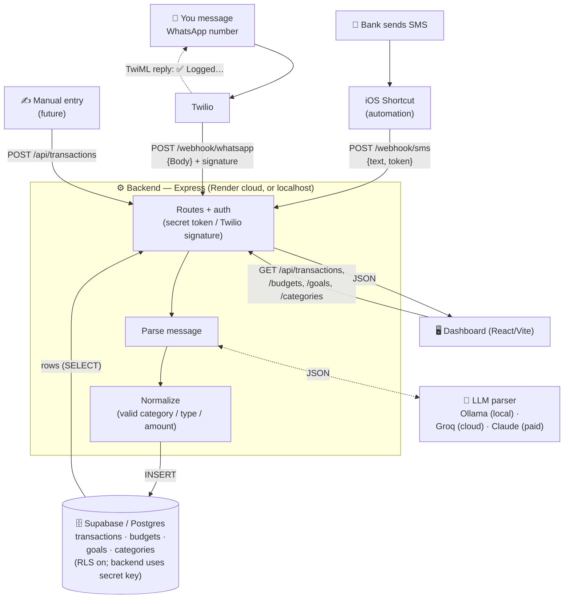

# Architecture

How data flows into and out of the personal finance tracker.

## Diagram

## In words

**Writes (money in/out get recorded):**
1. Your **bank sends an SMS** → an **iOS Shortcut automation** auto-forwards the text to `POST /webhook/sms` with the secret token.
2. You **message a WhatsApp number** → **Twilio** forwards it to `POST /webhook/whatsapp` (verified by Twilio signature, or the token locally).
3. **Manual entry** (future) posts straight to `POST /api/transactions`.

All three land in the **backend**, which: authenticates the request → sends the raw text to the **LLM parser** (Ollama locally, Groq in the cloud, or Claude) → gets back structured JSON `{amount, currency, merchant, type, category}` → normalizes it → **INSERTs a row into Supabase**. WhatsApp additionally gets a confirmation reply.

**Reads (you look at your money):**
- The **Dashboard** calls the backend API (`GET /api/transactions`, `/budgets`, `/goals`, `/categories`); the backend runs `SELECT`s against Supabase and returns JSON, which the UI renders as the spending chart, budget bars, and recent entries.

**Two environments, same database:**
- **Local dev** — backend on `localhost:3000`, parser = **Ollama** (free, on your Mac), frontend on `localhost:5173`.
- **Deployed** — backend on **Render** (public HTTPS, always-on), parser = **Groq** (free, hosted); the iOS Shortcut points at the Render URL. Both talk to the **same Supabase**, so data is shared.

**Security:** secrets live only in `.env` (gitignored) / Render env vars; webhooks require a token; Supabase has RLS on and only the backend's secret key can read/write.
