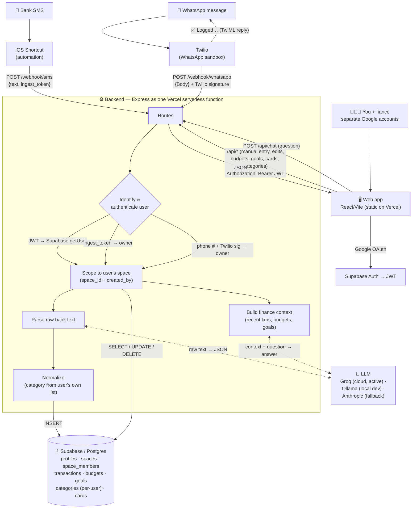

# Architecture

How data flows into and out of MoiMone — a multi-user personal finance tracker.
For free-tier limits and operational gotchas, see [OPERATIONS.md](./OPERATIONS.md).

## Diagram

> 📊 **Just want to see it?** Open [`architecture.html`](./architecture.html) in
> any browser — it's a self-contained render of the diagram below (no tools, no
> internet needed). The Mermaid source below also renders natively on GitHub.

## In words

### Who's who (multi-user)
Each person signs in with their **own Google account** (Supabase Auth → JWT).
Data is **private by default**: every row carries a `space_id` (which ledger it
lives in) and `created_by` (who added it). Today everyone has a personal space;
a shared "household" space is the planned Phase 2.

### Writes — money in/out gets recorded
Four entry points, all landing in the backend, each identifying *which user*:
1. **Bank SMS** → an **iOS Shortcut** forwards the text to `POST /webhook/sms`
   with that user's **ingest token** (the token both authenticates *and* says
   whose account it is).
2. **WhatsApp message** → **Twilio** forwards it to `POST /webhook/whatsapp`,
   authenticated by **Twilio signature** and matched to a user by their
   **registered phone number**.
3. **Manual entry / edits** (web app) → `POST/PUT /api/transactions` with the
   user's **JWT**.
4. **In-app Chat** → `POST /api/chat` (see below).

For SMS & WhatsApp the backend sends the raw text to the **LLM parser**, gets
back structured JSON `{amount, currency, merchant, type, category, …}`,
**normalizes** it against *that user's* category list, auto-links a registered
**card** by last-4 digits, and **INSERTs** the row scoped to the user's space.
WhatsApp also gets a confirmation reply.

### Reads — looking at your money
The web app calls `GET /api/transactions · /budgets · /goals · /categories ·
/cards`; the backend runs scoped `SELECT`s against Supabase and returns JSON,
rendered as the dashboard chart, budget bars, goals, and recent entries.

### In-app AI Chat
`POST /api/chat` assembles a compact summary of the user's own finances (recent
transactions, per-category totals, budgets, goals), sends it with the question
to the **LLM**, and returns a natural-language answer — using only that user's
data.

### Two environments, same database
- **Local dev** — backend on `localhost:3000`, parser = **Ollama** (free, on the
  Mac), frontend on `localhost:5173`.
- **Production** — frontend + backend deployed together on **Vercel**
  (`moi-mone.vercel.app`, same-origin `/api`), parser = **Groq** (free, hosted).
  Both point at the **same Supabase**, so data is shared.

### Security
- Supabase **service-role key** is backend-only (never in the browser); the
  browser uses the public **anon key** for Google login.
- Webhooks are authenticated — SMS by per-user **ingest token**, WhatsApp by
  **Twilio signature**.
- Access is scoped in code by `space_id` / `created_by`, so one user can't read
  another's private rows.
- All secrets live in `.env` (gitignored) locally and **Vercel env vars** in
  production.
