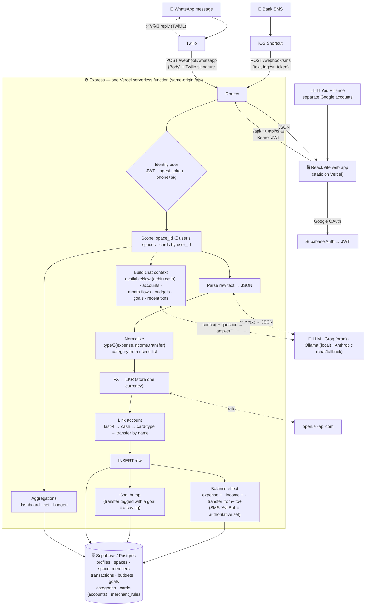

# Architecture

How data flows into and out of MoiMone — a multi-user personal finance tracker.
For free-tier limits and operational gotchas, see [OPERATIONS.md](./OPERATIONS.md).

## Diagram

> 📊 **Just want to see it?** Open [`architecture.html`](./architecture.html) in
> any browser — a self-contained render (no tools, no internet needed). The
> Mermaid source below also renders natively on GitHub.

## Data model

**Every transaction is exactly one of three types** — there is no separate
"savings" type:

| type | meaning | accounts | goal | category | payment_method |
|------|---------|----------|------|----------|----------------|
| `expense` | money spent | `card_id` (from) | — | yes | yes |
| `income` | money received | `card_id` (to) | — | yes | yes |
| `transfer` | money moved **between your own accounts**, and/or set aside | `card_id` (from) → `to_card_id` (to) | optional | `Transfer` | — |

- **A "saving" is a `transfer` tagged with a `goal_id`.** It moves money toward a
  goal (and out of spendable cash); it is not a distinct type.
- **Accounts** all live in one `cards` table, typed `credit · debit · cash · bank`,
  each with a `balance`. "Cards" and "Accounts" are the same thing.
- **All amounts are stored in LKR.** Foreign-currency messages are converted at
  ingest (the original is noted in `description`), so every calculation is
  single-currency.
- `transfer` rows never carry `payment_method` or `card_last4` (they're
  account→account); income/expense never carry a `goal_id`.

## Write path — how money gets recorded

Three write paths, each identifying *which user*:

1. **Bank SMS** → **iOS Shortcut** → `POST /webhook/sms` with the user's
   **ingest token** (authenticates *and* identifies the owner).
2. **WhatsApp** → **Twilio** → `POST /webhook/whatsapp`, verified by **Twilio
   signature**, matched to a user by **registered phone number**.
3. **Manual entry / edits** → `POST/PUT/DELETE /api/transactions` with the JWT.

(In-app **Chat** is *not* a write path — it's read-only Q&A; see Read path below.)

For SMS & WhatsApp the pipeline is: **parse → normalize → FX→LKR → link account →
INSERT → adjust balance → bump goal → reply**.

### Account linking (precedence)
1. exact **card by last-4** (real bank SMS) →
2. **cash** → the user's Cash account →
3. named **card type** ("from debit card") → the user's sole account of that type →
4. **transfers** match `from`/`to` by **account name**.

Unmatched only when genuinely ambiguous (e.g. two debit accounts, no last-4).

### Balance maintenance
- `expense` lowers its account, `income` raises it, `transfer` moves `from −` /
  `to +` (net-zero if both internal).
- A bank SMS that states an **available balance** is treated as **authoritative**
  (sets the balance directly); otherwise it's adjusted incrementally.
- Manual **edit/delete** use **reverse-old → apply-new**, so balances and goal
  progress never drift on changes.

## Read path — looking at your money

The web app calls `GET /api/transactions · /budgets · /goals · /categories ·
/cards`; the backend runs **scoped** `SELECT`s and returns JSON.

- **Dashboard** — Income / Spent / Saved are **monthly flows**; **Available** is a
  **live balance** (sum of `debit` + `cash` accounts). Plus by-category, by-account,
  and a 6-month trend.
- **Transactions** — net = income − expense − (goal-tagged transfers).
- **Budgets** — spend per category vs. each category's own limit.

### In-app AI Chat
`POST /api/chat` assembles a compact, **user-scoped** context — `availableNow`
(debit+cash, matching the dashboard), per-account balances, this/last-month flows,
budgets, goals, recent transactions — and sends it with the question to the LLM.
The model answers using only those pre-computed figures.

## Multi-user & scoping

Each person signs in with their **own Google account** (Supabase Auth → JWT).
Every row carries `space_id` (which ledger) and `created_by` (who added it).
Reads/writes are scoped in code: transactions/budgets/goals by
`space_id ∈ req.spaceIds` (the spaces you belong to), and accounts by `user_id`.
Today everyone has a **personal** space; a **shared** "household" space lets two
people share a ledger while keeping personal spaces private.

## Two environments, same database
- **Local dev** — backend on `localhost:3000`, parser = **Ollama** (free, on the
  Mac), frontend on `localhost:5173`.
- **Production** — frontend + Express deployed together on **Vercel**
  (`moi-mone.vercel.app`, same-origin `/api`), parser = **Groq**. Both point at
  the **same Supabase**, so data is shared.

## Security
- Supabase **service-role key** is backend-only (never in the browser); the
  browser uses the public **anon key** for Google login. The backend bypasses
  row-level security, so **isolation is enforced in code** by `space_id` /
  `created_by` / `user_id`.
- Webhooks are authenticated — SMS by per-user **ingest token**, WhatsApp by
  **Twilio signature**.
- All secrets live in `.env` (gitignored) locally and **Vercel env vars** in
  production.
